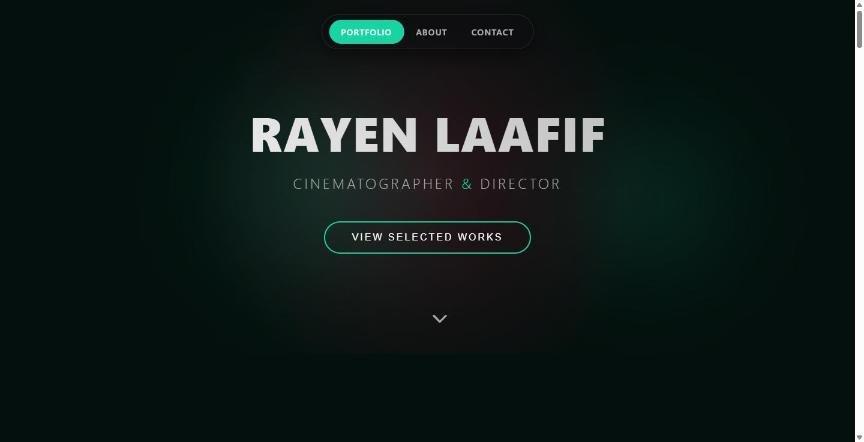

# Rayen Laafif — Cinematographer Portfolio


**Live:** [rayen-laafif.vercel.app](https://rayen-laafif.vercel.app)

A portfolio website I built for Rayen Laafif, a cinematographer and director. Films are streamed straight from his Google Drive, so he publishes new work without touching the code, and a private dashboard lets him edit descriptions and skills.



## Features

- **Showreel-first design** with cinematic page transitions (Framer Motion)
- **Google Drive as the video library**: thumbnails and playback are proxied through an API route, so files stay in his Drive
- **Private admin dashboard** to edit video descriptions and the skills list
- **Contact page** and about section

## Engineering

- Admin login with a salted PBKDF2-SHA256 hash (210,000 iterations) and an HMAC-signed session cookie, built on Web Crypto so the same code runs in Edge middleware and Node routes; `npm run set-admin-password` generates the environment values
- Route protection in `middleware.js`
- Content stored behind a small storage layer (`src/lib/store.js`) so it can move from a JSON file to a database on serverless hosts

## Run locally

```bash
npm install
cp .env.local.example .env.local
npm run set-admin-password "choose-a-password"   # prints the values for .env.local
npm run dev
```

## Author

Built by **Moktada Zaidi** — [GitHub](https://github.com/mo9tada) · [Portfolio](https://www.moktadazaidi.me)
